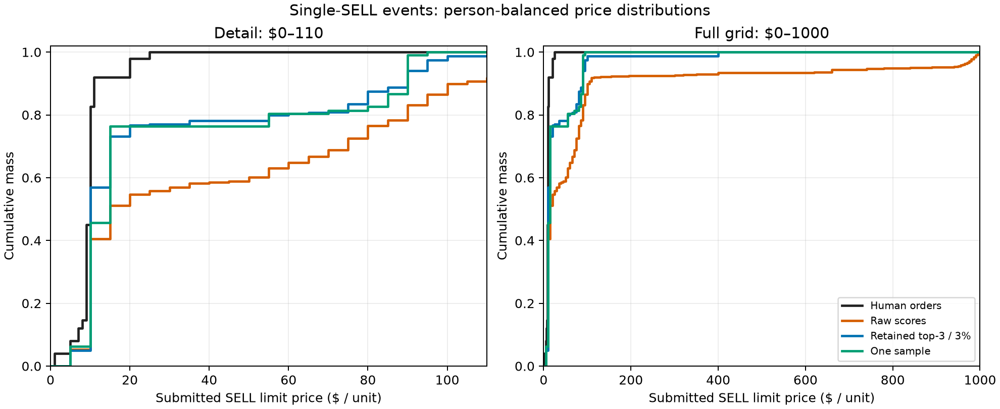

# 扩展SELL价格诊断：给定真人数量的结果

本研究使用既有GA10开发数据，预测价格时直接提供真人该笔SELL的精确数量；数量并非模型预测。输入还包括本人此前十轮实际历史及已核验历史利润、当前状态和中性规则说明。未提供目标价格、目标利润或当前其他订单。后续目标轮可看到此前目标轮的真实历史，因此这是逐轮静态预测，不是闭环市场模拟。

覆盖：35人、175个人轮次，先按当前 Q>D 选出30人、76事件；其中28人、71事件含106笔实际SELL。其余5个无SELL事件保留在覆盖分母，不视为0元报价。相同事件内相同数量共用一次推断，共101次物理请求；106/106笔获得报价。

主分析限定一笔SELL的事件；多笔事件及全部有SELL事件分别为次要描述。每人等权、每人内事件等权、事件内SELL分量等权；一次共用推断不增加独立样本。多笔事件中的其他当前订单未提供。

## 价格分布与条件误差

| 分组 | 人 / 事件 / SELL笔数 | 分布或抽样 | W1：真人原始价 | W1：真人5元投影 | 真人均价 / P95 | 模型均价 / P95 | 条件CRPS |
|---|---:|---|---:|---:|---:|---:|---:|
| 单笔SELL（主指标） | 25 / 49 / 49 | 原始分数 | 87.99 | 87.64 | 9.96 / 20.00 | 97.94 / 880.00 | 22.91 |
| 单笔SELL（主指标） | 25 / 49 / 49 | 截断后分布 | 21.07 | 20.73 | 9.96 / 20.00 | 31.03 / 95.00 | 11.38 |
| 单笔SELL（主指标） | 25 / 49 / 49 | 一次抽样 | 18.31 | 17.97 | 9.96 / 20.00 | 28.27 / 90.00 | 20.50 |
| 多笔SELL（次要描述） | 11 / 22 / 57 | 原始分数 | 90.24 | 89.82 | 10.22 / 20.00 | 100.30 / 960.00 | 20.67 |
| 多笔SELL（次要描述） | 11 / 22 / 57 | 截断后分布 | 25.48 | 25.17 | 10.22 / 20.00 | 35.29 / 95.00 | 10.70 |
| 多笔SELL（次要描述） | 11 / 22 / 57 | 一次抽样 | 10.97 | 10.58 | 10.22 / 20.00 | 20.89 / 75.00 | 12.02 |
| 全部有SELL事件 | 28 / 71 / 106 | 原始分数 | 88.76 | 88.39 | 9.93 / 20.00 | 98.68 / 940.00 | 22.17 |
| 全部有SELL事件 | 28 / 71 / 106 | 截断后分布 | 20.26 | 19.88 | 9.93 / 20.00 | 30.16 / 95.00 | 10.47 |
| 全部有SELL事件 | 28 / 71 / 106 | 一次抽样 | 15.96 | 15.55 | 9.93 / 20.00 | 25.84 / 90.00 | 17.75 |

## 如何理解主结果

单笔SELL中，真人及截断后模型的中位数均为10.00美元：模型识别到低价中心，但高价质量仍偏多。真人价格不超过20美元的质量为98.00%，模型截断后为76.77%；截断后≥65美元的质量为19.63%。
主指标对真人原价W1为21.07，对5元投影为20.73，网格投影对这一差距的影响较小。单次抽样W1为18.31，低于截断分布的21.07；多笔事件对应10.97与25.48。一次预定抽样并不能说明分布稳定改善。
原始≥700美元质量5.60%，截断后为0.00%，因此本次抽样没有≥700美元报价；这不表示所有高价尾部均已消失。逐人留一敏感性W1范围15.41–22.21；每次移除一人后边际差距仍存在，但该范围不是置信区间。

下一步优先离线关联高价质量与当前价格、状态及本人历史SELL，并比较匹配历史检索基线；随后单独设计历史使用干预。这里不追加调用、不改变默认方案或缩减候选网格。

价格与距离单位均为每单位美元。W1比较按上述权重合并的人类与模型价格分布，越低表示边际分布越接近；主指标是单笔SELL、截断后分布对真人原始价格的W1。条件CRPS逐笔以该笔真人原价为观测值，再按同样的嵌套权重汇总；单次抽样的CRPS是点预测绝对误差，不证明校准。

原始分数先经合法性检查和归一化，但没有证据证明它们是已校准的人类选择概率。截断后分布是实际客户端规则：按原始分数筛选达到3%的候选、最多保留前三项并重新归一化；抽样是一条预定随机数实现。三者不可互换。真人5元网格投影仅作敏感性分析；例如1元投影到5元相差4元。



图左放大0–110美元，图右展示完整0–1000美元区间。曲线为加权累积分布；原始分数的远端尾部与截断后的实际客户端分布分开显示。

## 尾部与局限

| 分组 | 表示 | ≥65质量 | ≥700质量 | 高于本人零售价的质量 |
|---|---|---:|---:|---:|
| 单笔SELL（主指标） | 原始分数 | 35.16% | 5.60% | 26.75% |
| 单笔SELL（主指标） | 截断后分布 | 19.63% | 0.00% | 12.51% |
| 单笔SELL（主指标） | 一次抽样 | 19.67% | 0.00% | 17.33% |
| 多笔SELL（次要描述） | 原始分数 | 36.33% | 5.87% | 26.17% |
| 多笔SELL（次要描述） | 截断后分布 | 20.19% | 0.00% | 13.31% |
| 多笔SELL（次要描述） | 一次抽样 | 13.64% | 0.00% | 12.27% |
| 全部有SELL事件 | 原始分数 | 35.63% | 5.81% | 26.33% |
| 全部有SELL事件 | 截断后分布 | 19.57% | 0.00% | 11.96% |
| 全部有SELL事件 | 一次抽样 | 18.02% | 0.00% | 15.40% |

尾部事件是描述统计；SELL限价不等于成交价，高于本人零售价也不自动意味着错误。真人原始限价可不在5元网格上；模型候选仍只有5元网格，未作抖动。

所有参与者此前均已在本项目中使用，不能称为新留出集或独立确认。此前8人研究使用旧模型选出的固定数量，本研究使用真人数量、更多个人轮次与不同条件；两者不是配对因果对照，不能据此断言数量改变导致效果改善。也不能把结果解释为完整代理的表现或模型能力上限。

## 运行与复核

- 101次物理请求，677,465输入tokens，核算USD0.028453530；费用硬上限USD0.30。
- 10路并发上限，实际峰值7；HTTP区间25.75秒，最大滚动一秒4请求及48,000预留字节。
- 请求、响应、费用与抽样经严格回放；旧版本的失败证据保留。本次没有执行20轮市场。
- 完整运行与本地命令参见 [V2操作说明](../engineering/jev-sell-oracle-v2.md)。公开渲染仅读取隐私过滤后的汇总JSON。

```powershell
python -m tools.probes.jev_sell_oracle_v2 preview
python -m tools.probes.jev_sell_oracle_v2 replay
python -m tools.probes.jev_sell_oracle_v2 report
python -m tools.analysis.report_jev_sell_oracle_v2
```

预览及回放需要本机已授权数据或私有证据；不要重复启动已运行目录。
