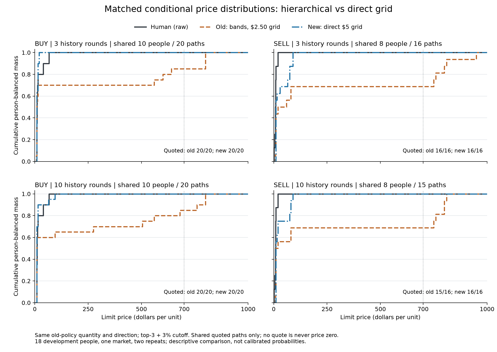
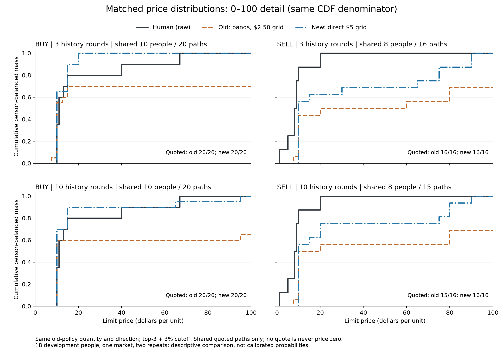

# 5元直接网格：匹配数量的真实Jev价格对照

同18名开发参与者，预测正式第11轮（游戏第16轮）。短历史为正式8–10轮，长历史为正式1–10轮；每人每条件两次重复，共72条路径。

**本次只重新请求价格。** 每条路径的真人当前状态、历史、给定方向以及旧3%流程已选数量保持不变。新接口一次选择5、10、…、995这199个完整价格；旧接口先选价带、再从价带选2.5元网格价格。两组都使用top-3＋原始概率至少3%的截断采样。

保留原观察者预测提示，仅修改末尾价格选择说明及网格文字。没有重跑数量、方向、STOP、多订单或20轮市场。网格精度和分层生成接口同时改变，不能把结果唯一归因于5元间距。

## 本次发现

四个分组的价格分布W1均明显下降；≥700元实际报价从15/72降至0/72，>250元从22/72降至0/72。新接口72/72都给出价格，改善并非通过增加弃权实现。

这表明，在相同数量和可见历史下，替换价格生成方式能大幅改变Jev的拟真人表现；不能把旧高价直接解释为模型普遍不能处理数字。旧新调用发生在不同时间，且生成接口、网格及必要措辞共同变化；尚未唯一定位因果机制。

卖价仍偏高：共同成功口径下，三轮/十轮新卖价均值分别33.13/29.38元，真人8.75元；新卖价P95均为90元，真人20元。投影到5元后的卖价W1仍为23.13/19.38元，因此余下差距主要不是几元舍入可以解释。买价长历史均价18.00元接近真人19.75元，但整体接近不证明每位参与者均被准确预测，也未检验完整条件分布校准。

## 价格分布与覆盖

W1为按人等权的合并价格分布与同一批真人原始报价之间的Wasserstein距离，单位为元，越小越接近；不是个人逐笔命中或平均个人误差。真人一人多单时，该人内部订单等权；模型两次重复在共同成功路径中等权。每行旧、新使用完全相同的人和成功路径。

| 历史 / 方向 | 共同人数 / 路径 | 旧有效 / 计划 | 新有效 / 计划 | 旧W1 | 新W1 | 新−旧 |
|---|---:|---:|---:|---:|---:|---:|
| 三轮历史 / BUY | 10 / 20 | 20/20 | 20/20 | 198.40 | 7.70 | -190.70 |
| 三轮历史 / SELL | 8 / 16 | 16/16 | 16/16 | 264.84 | 24.38 | -240.47 |
| 十轮历史 / BUY | 10 / 20 | 20/20 | 20/20 | 210.50 | 4.55 | -205.95 |
| 十轮历史 / SELL | 8 / 15 | 15/16 | 16/16 | 252.34 | 20.63 | -231.72 |

有效报价率须与分布距离一起阅读。所有候选低于3%时是客户端数值弃权，不是0元、真人STOP或技术失败；不把它补零，也不通过删除弃权宣称完整行为改善。

| 历史 / 方向 | 真人均价 | 旧均价 / 中位数 / P95 | 新均价 / 中位数 / P95 | 旧 / 新：对5元投影真人W1 |
|---|---:|---:|---:|---:|
| 三轮历史 / BUY | 19.75 | 217.50 / 10.00 / 800.00 | 12.25 / 10.00 / 20.00 | 198.25 / 7.25 |
| 三轮历史 / SELL | 8.75 | 273.59 / 20.00 / 950.00 | 33.13 / 10.00 / 90.00 | 263.59 / 23.13 |
| 十轮历史 / BUY | 19.75 | 229.75 / 10.00 / 800.00 | 18.00 / 10.00 / 65.00 | 210.25 / 4.50 |
| 十轮历史 / SELL | 8.75 | 261.09 / 10.00 / 810.00 | 29.38 / 10.00 / 90.00 | 251.09 / 19.38 |

5元投影仅检验网格表示误差，保留完整的原始真人报价作为主要参考；不是观察到真人在新网格下的行为。

## 高价尾部

以下计数使用每种方法的全部计划路径，不限共同成功子集。≥700包括800元以上；“700多”单独定义为700≤价格<800，800元不属于该窄区间。事件数/计划数不把弃权当低价；另报有效报价中的比例。

| 历史 / 方向 / 接口 | ≥700：次数/计划（有效报价内） | 700–<800：次数/计划 | >250：次数/计划 | 高于当轮p：次数/计划 | 弃权 |
|---|---:|---:|---:|---:|---:|
| 三轮历史 / BUY / 旧分区间 | 3/20（15.0%） | 0/20 | 6/20 | 6/20 | 0 |
| 三轮历史 / BUY / 新直接5元 | 0/20（0.0%） | 0/20 | 0/20 | 0/20 | 0 |
| 三轮历史 / SELL / 旧分区间 | 5/16（31.2%） | 2/16 | 5/16 | 5/16 | 0 |
| 三轮历史 / SELL / 新直接5元 | 0/16（0.0%） | 0/16 | 0/16 | 3/16 | 0 |
| 十轮历史 / BUY / 旧分区间 | 3/20（15.0%） | 1/20 | 7/20 | 7/20 | 0 |
| 十轮历史 / BUY / 新直接5元 | 0/20（0.0%） | 0/20 | 0/20 | 0/20 | 0 |
| 十轮历史 / SELL / 旧分区间 | 4/16（26.7%） | 2/16 | 4/16 | 4/16 | 1 |
| 十轮历史 / SELL / 新直接5元 | 0/16（0.0%） | 0/16 | 0/16 | 1/16 | 0 |

完整JSON另保留弃权所对应假设未报价格的敏感性界；该界不是置信区间，也不声称弃权实际有一个隐藏报价。

| 历史 / 方向 | 旧未截断模型分数≥700质量 | 新未截断模型分数≥700质量 |
|---|---:|---:|
| 三轮历史 / BUY | 18.7% | 4.4% |
| 三轮历史 / SELL | 18.1% | 4.9% |
| 十轮历史 / BUY | 19.4% | 4.3% |
| 十轮历史 / SELL | 15.4% | 2.6% |

旧分数质量按价带概率×各价带条件价格概率求和，新分数直接来自199项；均条件于相同旧数量、位于截断前。两者不是已经校准的真人行为概率，不能将分数变化解释成已证实的心理机制。

事后阈值核对（另存tail-audit JSON）：本批所有≥700元候选的单项原始分数最高2%，均低于3%门槛，所以在本批截断支持里没有高价候选。高价合计分数仍有约2.6%–4.9%；0次高价不能改写为模型高价概率为0。实际新报价范围10–95元，provider choice非最大项及域外异常均为0。该补充是离线诊断，没有新增调用。





## 执行与可复现性

- 实际请求72次，输入463,444 tokens，按冻结价表核算USD 0.019465，硬上限USD 0.25。
- 10路并发上限；按真实HTTP时间重建峰值7路，耗时17.97秒；最大滚动一秒4请求、48,000预留字节。
- jev-1.14.0；原始响应、候选顺序、截断支持、随机数、选择、请求/响应哈希及预算均严格回放。无自动重试或补跑。
- 离线定向回归47项通过，另经独立本地审查。计划和源代码冻结后执行；本次未新增Opus咨询。
- 冻结计划SHA256：`8891b9242ff05f4df240ceac454a9aa7c3cccfe47ef581d9f458febbbe8aa281`。
- 逐人记录、完整状态、API请求和密钥只留本机；此报告与JSON仅为安全汇总。

## 解释边界与下一步

这是同市场开发样本上的条件选价诊断，两个重复不增加独立真人数，也不足以验证概率校准。降低高价尾部不等于整组订单像真人；接近总体分布也不意味着逐个人预测准确。覆盖下降、低价集中或条件分布丢失都须与W1一起判断。

建议将直接5元网格保留为新的开发候选，旧版冻结不变。下一步若要识别原因，应在相同5元叶节点和措辞下对比分层/直接生成；若优先改善拟真人效果，应先离线检查剩余65–90元SELL报价及历史低价信息的使用。两种目的分开，尚未执行新增对照或自动修改阈值。完整多单和闭环市场需另行冻结验证。

本地只读复核（已配置项目环境后，在仓库根目录）：

```powershell
python -m tools.probes.jev_flat_grid5_study replay
python -m tools.probes.jev_flat_grid5_study report
python -m tools.analysis.report_jev_flat_grid5
```

`run`具有一次性启动标记，不可用于自动重跑；私有源数据与既有冻结证据不随GitHub分发。
