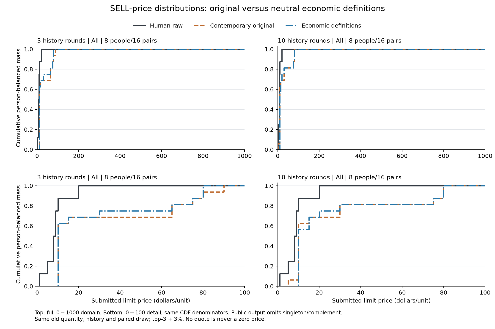

# SELL规则语义：与同期原版的配对对照

同原批次8位卖方，预测正式第11轮（游戏第16轮）；三轮历史为正式8–10轮，十轮为正式1–10轮，各两次重复。每个窗口、每个版本16条价格预测，共64次真实请求。

**原版重新调用，作为同期对照，不是复用上次32条卖价。** 每对的本人历史、当前状态、方向、旧路径已选数量、199个完整价格5–995、原始top-3＋3% cutoff及抽样随机数相同。版本与窗口不改变抽样坐标；两个重复分时间块，版本交错。只有规则版在状态中追加一个中性定义字段。没有新增成交反馈、他人历史、收益计算或推荐动作。

## 本次效果

| 历史 | 原版价格分布W1 | 规则版W1 | 规则−原版 | 原版／规则版有效报价 |
|---|---:|---:|---:|---:|
| 三轮历史 | 21.88 | 19.06 | -2.81 | 16/16 ／ 16/16 |
| 十轮历史 | 16.56 | 16.56 | 0.00 | 16/16 ／ 16/16 |

主指标是按人等权的**合并报价分布**与真人原始同方向限价的W1，单位元，越低越近；不是平均逐人误差。每行两版取完全相同的共同成功路径，真人同一人多单时内部订单等权、模型重复内部等权。

结论：三轮历史出现小幅开发集改善，十轮历史的总体分布距离未变；补齐这组规则尚未解决剩余卖价偏高。总体W1不变不代表每个人或每个原始概率都不变。两个重复不足以校准模型概率或确认稳定效果，不能据此宣布语义无作用或模型存在固有能力上限。

## 本人SELL历史分组

每个历史窗口均为7人有本人SELL记录、1人无SELL记录。完整分组结果已保存本机私有报告。为了避免通过“全部8人−其中7人”重建单人的行为数据，公开报告不展示两个子组的数值分布。总体分母仍保留全部8人。

分组定性结果：有历史组在短窗口改善，长窗口与真人的总体分布距离未变，并不表示CDF相同；无历史的单人案例在短窗口略有改变，长窗口样本价格未改变，其高价偏差仍明显。不能用7对1的开发比较建立组间因果结论。

## 均价、尾部和网格敏感性

| 历史 / 组别 | 真人均价 | 原版均价 / P95 | 规则版均价 / P95 | 原版／规则版对5元投影真人W1 |
|---|---:|---:|---:|---:|
| 三轮历史 / 全部 | 8.75 | 30.63 / 90.00 | 27.81 / 80.00 | 20.63 ／ 17.81 |
| 十轮历史 / 全部 | 8.75 | 25.31 / 80.00 | 25.31 / 80.00 | 15.31 ／ 15.31 |

| 历史 / 组别 / 版本 | ≥65元 / 计划 | ≥700元 / 计划 | >本人零售价 / 计划 | 客户端弃权 |
|---|---:|---:|---:|---:|
| 三轮历史 / 全部 / 原版 | 5/16 | 0/16 | 3/16 | 0 |
| 三轮历史 / 全部 / 规则版 | 4/16 | 0/16 | 1/16 | 0 |
| 十轮历史 / 全部 / 原版 | 3/16 | 0/16 | 0/16 | 0 |
| 十轮历史 / 全部 / 规则版 | 3/16 | 0/16 | 0/16 | 0 |

尾部是描述，不把SELL高于本人p自动视为错误：其他参与者的p不同。报价不等于成交价，提交不等于成交。弃权不是0元或真人STOP，技术失败不能被当作空单。网格投影只衡量表示敏感性，不等同于观察真人适应新网格。

## 原始分数与截断抽样

| 历史 / 组别 / 版本 | 截断前≤20质量 | 截断后≤20质量 | 截断前≥65质量 | 截断后≥65质量 |
|---|---:|---:|---:|---:|
| 三轮历史 / 全部 / 原版 | 48.18% | 65.63% | 41.49% | 28.83% |
| 三轮历史 / 全部 / 规则版 | 52.06% | 71.68% | 36.91% | 21.43% |
| 十轮历史 / 全部 / 原版 | 50.68% | 75.08% | 36.88% | 17.93% |
| 十轮历史 / 全部 / 规则版 | 50.07% | 75.15% | 34.93% | 16.42% |

这里先验证并归一化API返回的完整分数，再分别统计截断前与top-3＋3%后的分布；并非模型已校准的真人选择概率。截断前后、实际抽到的价格是三个不同对象。完整原始总和、支持与随机数留在私有证据中。

## 本次只增加的原文

```text
own_p is revenue per unit of this participant's own demand D served, not an order limit or market price. Other participants have different private p. The wholesale cost of Q was incurred before D was revealed. Units neither used to serve own demand nor sold expire at round end with no salvage value. Orders are blind limits: a BUY limit is the maximum acceptable unit price; a SELL limit is the minimum. Bids rank highest first and asks lowest first. Fills may be partial or zero. All fills in a market trade at one uniform price: the midpoint of the last matched bid and ask. An order's fill price can differ from its limit; a limit can affect the clearing price when marginal. Historical order prices are submitted limits, not realized prices. These definitions describe the rules, not a recommended action.
```

这组文字未提示低价、最优策略或目标答案。结果仅评价这组定义的整体作用，不能分解哪句话有用。

## 边界、验证和本地复核

目标是条件行为分布。当前仍固定旧模型数量，而真人可能选择不同数量；数量和价格的相关关系尚未处理，1元等真人报价也不在新网格内。真实人的规则知识与完整经历无法由这些输入完全恢复。一个市场的8名开发参与者、两个重复不构成独立确认；不得从无改善唯一归因为模型能力、训练数据或个体异质性。

- 64次请求、420,544输入tokens，按冻结价表核算USD0.017662848；发送前硬上限USD0.25。
- 10路并发上限，实测峰值8，耗时16.422秒；最大滚动一秒4请求、48,000预留字节。
- 旧实验及提示未改。64请求体最大11609字节，未截断；零自动重试。严格回放校验请求/响应/抽样/费用，独立复算价格距离。
- 离线共享回归63项通过；生命周期修复与隐私过滤后的17项新测试通过，最终过滤小改后的8项分析测试再通过。未运行20轮市场。
- 冻结SHA256：`6c17157cfa06583ca019aa13e020e554e0cfc74def6482656673678e8f8f96fc`。

建议保留这次语义完整版本作为开发记录，但不称作已验证的新默认。下一步先离线核对仍高价者的SELL历史、原始价格分数、数量条件和真实信息缺口；本报告不自动追加调用或改变抽样。

```powershell
python -m tools.probes.jev_sell_semantics replay
python -m tools.probes.jev_sell_semantics report
python -m tools.analysis.report_jev_sell_semantics
```

前两条需要本机完整私有冻结证据；渲染公开报告只需已有汇总JSON、提示快照及Matplotlib。不要对已经启动的目录再次执行run。


